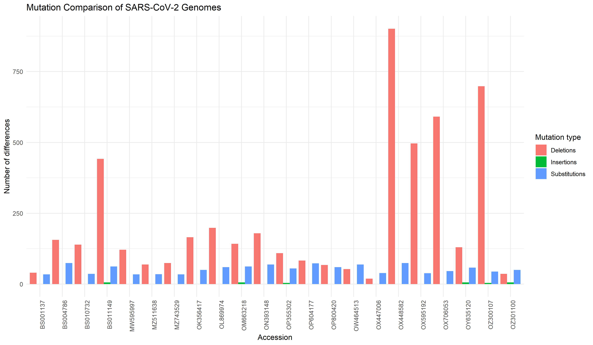
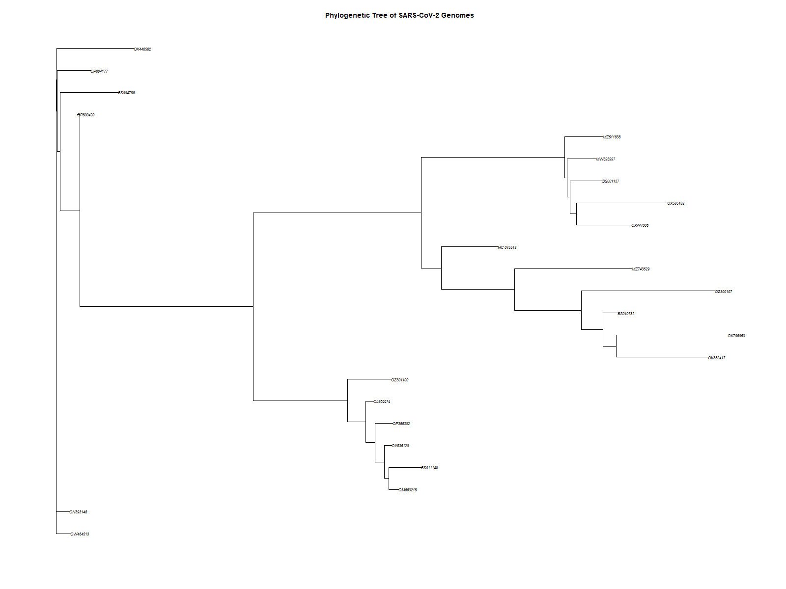
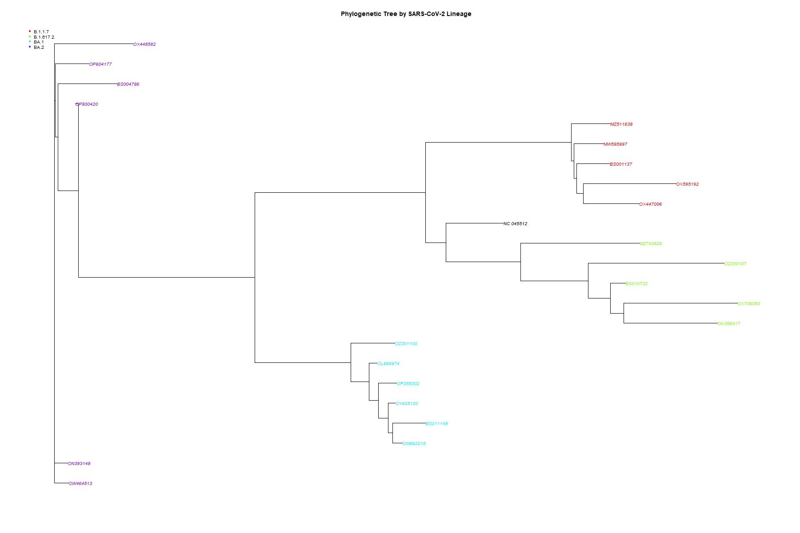
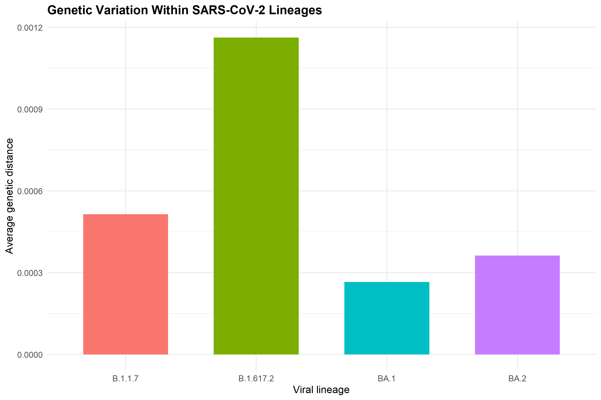

# Viral Sequence Analysis and Phylogenetics of SARS-CoV-2 Genomes

Abstract:
This project investigates genetic variation and phylogenetic relationships among 22 publicly available SARS-CoV-2 genomes representing Alpha, Delta, Omicron BA.1, and Omicron BA.2 lineages. Using the Wuhan-Hu-1 reference genome (NC_045512.2), sequence quality was assessed, and multiple sequence alignment was performed. Mutations and pairwise genetic distances were analysed, followed by the construction of a Neighbor-Joining phylogenetic tree. Among the selected samples, BA.1 showed the lowest average within-lineage genetic distance, while Delta showed the highest. The study demonstrates a reproducible bioinformatics workflow while acknowledging limitations related to sample size and sequence quality.

# 1. Introduction

## 1.1 Background

Severe Acute Respiratory Syndrome Coronavirus 2 (SARS-CoV-2) is the virus responsible for Coronavirus Disease 2019 (COVID-19). Since its emergence, the virus has accumulated genetic changes over time, resulting in the development of multiple genetic lineages.

Analysing viral genome sequences helps researchers understand genetic variation, identify similarities and differences between viral genomes, and investigate evolutionary relationships among sampled sequences.

Bioinformatics provides computational methods for analysing biological sequence data. Sequence alignment, mutation analysis, genetic distance calculation, and phylogenetic tree construction are important techniques used to investigate genetic relationships between organisms and viruses.

## 1.2 Problem Statement

SARS-CoV-2 genomes belonging to different lineages may contain different genetic variations. However, the extent of genetic similarity within and between selected lineages needs to be examined through sequence-based analysis.

This project investigates the genetic variation and evolutionary relationships among selected SARS-CoV-2 genome sequences representing four lineages: Alpha (B.1.1.7), Delta (B.1.617.2), Omicron BA.1, and Omicron BA.2.

## 1.3 Objectives

The main objectives of this project are:

- To collect publicly available SARS-CoV-2 genome sequences and associated metadata.
- To perform quality assessment of the collected sequences.
- To align the selected genomes with the Wuhan-Hu-1 reference genome.
- To identify substitutions, insertions, and deletions relative to the reference.
- To calculate genetic distances between the selected genomes.
- To construct a Neighbor-Joining phylogenetic tree.
- To compare genetic variation within the selected viral lineages.

## 1.4 Scope

The study focuses on 22 publicly available SARS-CoV-2 genome sequences representing four selected lineages. The Wuhan-Hu-1 reference genome (NC_045512.2) is included as a reference for sequence comparison.

The analysis is conducted using the R programming language and relevant bioinformatics packages. The findings are limited to the selected sequences and should not be interpreted as representing the complete global diversity of SARS-CoV-2.

# 2. Methodology

## 2.1 Data Collection

SARS-CoV-2 genome sequences were obtained from the National Center for Biotechnology Information (NCBI) database. A total of 22 genome sequences were selected, representing four viral lineages:

- Alpha (B.1.1.7): 5 sequences
- Delta (B.1.617.2): 5 sequences
- Omicron BA.1: 6 sequences
- Omicron BA.2: 6 sequences

The Wuhan-Hu-1 reference genome (NC_045512.2) was downloaded separately and used as the reference sequence for comparative analysis.

Associated metadata, including accession numbers, lineage classifications, genome lengths, geographical locations, and collection dates, were collected for the selected genomes.

## 2.2 Tools and Libraries

The analysis was performed using the R programming language. The following packages were used:

| Package | Purpose |
|---|---|
| Biostrings | Importing and handling DNA sequences |
| DECIPHER | Multiple sequence alignment |
| ape | Genetic distance calculation and phylogenetic analysis |
| ggplot2 | Data visualization |

## 2.3 Data Quality Assessment

The collected genome sequences were examined to assess their quality and completeness.

The following characteristics were calculated:

- Genome length: total number of nucleotide positions.
- GC content: percentage of guanine (G) and cytosine (C) nucleotides.
- Ambiguous bases: nucleotide positions that could not be identified as A, C, G, or T.

A provisional screening threshold of 5% ambiguous bases was used to identify sequences requiring further review. Sequences exceeding this threshold were flagged rather than automatically removed from the analysis.

## 2.4 Multiple Sequence Alignment

The 22 selected SARS-CoV-2 genomes and the Wuhan-Hu-1 reference genome were combined into a single sequence dataset.

Multiple sequence alignment was performed using the AlignSeqs function from the DECIPHER package.

The purpose of alignment was to arrange homologous nucleotide positions so that genetic differences between the reference and sample sequences could be compared.

The resulting aligned sequences were saved in FASTA format for subsequent analysis.

## 2.5 Mutation Analysis

Mutation analysis was performed by comparing each aligned sample sequence with the aligned Wuhan-Hu-1 reference genome.

Three categories of sequence differences were examined:

- Substitutions: positions where both sequences contained valid nucleotides but the nucleotides differed.
- Insertions: nucleotide positions where a sample contained a nucleotide while the reference contained an alignment gap.
- Deletions: positions where the reference contained a nucleotide while the sample contained an alignment gap.

Ambiguous positions were also counted separately to identify locations that could not be reliably compared.

The resulting mutation counts were stored in a summary table and visualized using a grouped bar chart.

## 2.6 Genetic Distance Calculation

Pairwise genetic distances were calculated using the dist.dna function from the ape package.

The raw distance model was selected to estimate the proportion of nucleotide differences between pairs of sequences.

Pairwise deletion was enabled so that positions containing gaps or ambiguous nucleotides in either sequence were excluded from the comparison.

This approach allowed genetic distances to be calculated despite the presence of incomplete or ambiguous positions in some sequences.

## 2.7 Phylogenetic Tree Construction

A Neighbor-Joining (NJ) phylogenetic tree was constructed using the calculated pairwise genetic distance matrix.

The Neighbor-Joining method groups sequences according to their genetic distances and provides a representation of their evolutionary relationships.

The resulting tree was saved in Newick format and visualized using the ape package.

The tree was subsequently annotated using the known lineage classifications obtained from the metadata to facilitate comparison between phylogenetic groupings and lineage information.

# 3. Results and Analysis

## 3.1 Genome Quality Assessment

A total of 22 SARS-CoV-2 genome sequences were examined during the quality assessment stage.

The genome lengths ranged from 29,467 to 29,893 nucleotides, with an average length of approximately 29,801 nucleotides.

The GC content ranged from 37.81% to 38.28%, with an average of approximately 37.96%.

The sequences were also examined for ambiguous nucleotide positions. Using a provisional threshold of more than 5% ambiguous bases, 18 sequences passed the initial screening, while 4 sequences were flagged for further review.

These findings indicate that most selected sequences had relatively similar genome lengths and GC content. However, the presence of ambiguous positions in some sequences highlights the importance of quality assessment before performing comparative genomic analysis.

## 3.2 Multiple Sequence Alignment

The 22 sample genomes and the Wuhan-Hu-1 reference genome were successfully aligned using the DECIPHER package.

The alignment contained 23 sequences, with a final aligned length of 32,541 nucleotide positions.

The aligned sequences contained gaps introduced during the alignment process. These gaps helped represent differences in sequence length and nucleotide positions between the genomes.

The resulting alignment provided the basis for mutation analysis and genetic distance calculation.

## 3.3 Mutation Analysis

The aligned genomes were compared against the Wuhan-Hu-1 reference genome to identify nucleotide differences.

The number of substitutions ranged from 34 to 74 across the selected samples.

The number of insertions ranged from 0 to 6, while the alignment-derived deletion counts ranged from 19 to 901.

Ambiguous positions varied considerably between samples, ranging from 0 to 4,545.

The results demonstrated that the selected genomes contained different levels and types of nucleotide differences relative to the reference genome.

However, the relatively high deletion counts in some sequences should be interpreted cautiously. Alignment gaps can result from incomplete sequence coverage or terminal missing regions, in addition to genuine biological deletions. Therefore, these counts represent candidate alignment-derived deletions rather than independently confirmed biological deletion events.

A grouped bar chart was generated to compare substitutions, insertions, and deletions across the selected genomes.

## 3.4 Phylogenetic Analysis

A Neighbor-Joining phylogenetic tree was successfully constructed using the pairwise genetic distance matrix.

The tree contained 23 tips, representing the 22 selected SARS-CoV-2 genomes and the Wuhan-Hu-1 reference genome.

The tree was annotated using the lineage information available in the collected metadata. Different colours were assigned to the four selected lineages to make their distribution within the tree easier to examine.

This visualization provides a way to investigate whether sequences assigned to the same lineage appear close to one another in terms of their genetic relationships.

The tree represents genetic similarity among the selected sequences. It does not establish direct transmission relationships or the precise historical pathway of viral evolution.

## 3.5 Genetic Distance Within Lineages

Average pairwise genetic distances were calculated separately for each of the four selected lineages.

The results are summarized below.

| Lineage | Average genetic distance |
|---|---:|
| Alpha (B.1.1.7) | 0.0005145 |
| Delta (B.1.617.2) | 0.0011630 |
| Omicron BA.1 | 0.0002662 |
| Omicron BA.2 | 0.0003633 |

Among the selected groups, BA.1 showed the lowest average within-lineage genetic distance, indicating the greatest genetic similarity among its sampled genomes.

BA.2 also showed relatively low within-lineage genetic distance. Alpha showed a higher average distance than both BA.1 and BA.2.

Delta had the highest average within-lineage genetic distance among the four groups, suggesting greater genetic variation within the selected Delta samples.

These findings are specific to the 22 genomes selected for this project. They should not be generalized to all viruses belonging to these lineages.

# 4. Data Visualizations

## 4.1 Mutation Comparison

The following figure compares the number of substitutions, insertions, and deletions identified in each selected genome relative to the Wuhan-Hu-1 reference.

## 4.2 Phylogenetic Tree

The following Neighbor-Joining tree illustrates the genetic relationships among the 22 selected genomes and the Wuhan-Hu-1 reference genome.

## 4.3 Phylogenetic Tree by Lineage

The tree below uses different colours to represent the known lineage classifications of the selected genomes. The reference genome is displayed separately.

## 4.4 Genetic Distance Comparison

The following bar chart compares the average within-lineage genetic distances for Alpha, Delta, BA.1, and BA.2.

# 5. Discussion

The analysis provided an overview of genetic variation and relationships among 22 selected SARS-CoV-2 genomes representing Alpha, Delta, BA.1, and BA.2 lineages.

The quality assessment showed that the selected genomes had relatively consistent lengths and GC content. However, four sequences exceeded the provisional 5% ambiguous-base screening threshold. This demonstrates why sequence quality should be considered when interpreting comparative genomic results.

Multiple sequence alignment provided a common coordinate system for comparing the genomes. The subsequent mutation analysis identified substitutions, insertions, and alignment-derived deletions relative to the Wuhan-Hu-1 reference genome. The variation in mutation counts indicates that the selected genomes do not share identical nucleotide sequences.

The genetic distance analysis revealed differences in the average within-lineage genetic distances. BA.1 had the lowest average distance, whereas Delta had the highest. This suggests that the sampled BA.1 genomes were more genetically similar to one another than the sampled Delta genomes.

The phylogenetic tree provided a visual representation of the genetic relationships among the selected genomes. Comparing the tree with the known lineage classifications helped examine whether the genetic groupings were consistent with the available metadata.

Overall, the results demonstrate how sequence alignment, mutation analysis, genetic distance calculations, and phylogenetic methods can be combined to investigate viral genetic variation.

# 6. Limitations

Several limitations should be considered when interpreting the results.

1. **Limited sample size:** Only 22 SARS-CoV-2 genomes were analysed. Therefore, the results do not represent the complete genetic diversity of the selected lineages.

2. **Uneven sampling:** The samples were collected from different geographical locations and collection dates. The selection may not represent the distribution of lineages across countries or periods.

3. **Sequence quality:** Some genomes contained relatively high proportions of ambiguous nucleotide positions. Although these positions were considered during quality assessment, they may affect mutation counts and genetic distance estimates.

4. **Alignment-derived deletions:** Gaps in aligned sequences may represent genuine deletions or incomplete sequence coverage. The deletion counts were not independently validated as biological deletion events.

5. **Distance calculation:** Raw genetic distances were calculated using pairwise deletion. Consequently, different sequence pairs may have been compared using different numbers of valid nucleotide positions.

6. **Phylogenetic interpretation:** The Neighbor-Joining tree was constructed from genetic distances and does not independently establish direct transmission events or the exact evolutionary history of the virus.

7. **Limited evolutionary analysis:** The study did not include extensive bootstrap support assessment or a detailed time-calibrated evolutionary analysis.

# 7. Conclusion

This project investigated genetic variation and phylogenetic relationships among 22 selected SARS-CoV-2 genome sequences representing four lineages: Alpha, Delta, Omicron BA.1, and Omicron BA.2.

Using R and bioinformatics packages, the study performed sequence quality assessment, multiple sequence alignment, mutation analysis, genetic distance calculation, and Neighbor-Joining phylogenetic tree construction.

The results showed variation in nucleotide differences among the selected genomes. The within-lineage genetic distance analysis indicated that BA.1 had the lowest average genetic distance, while Delta had the highest among the sampled groups.

The project demonstrated the practical application of bioinformatics techniques in comparative viral genome analysis. It also highlighted the importance of sequence quality, appropriate analytical methods, and careful interpretation when studying genetic relationships.

Future work could include analysing a larger and more geographically diverse collection of genomes, investigating specific mutation positions, and applying additional phylogenetic methods to assess evolutionary relationships in greater detail.

# 8. Reproducibility

The analysis was performed using R and the RStudio environment.

To reproduce the analysis:

1. Clone or download this GitHub repository.
2. Open `2021-ASP-60.Rproj` in RStudio.
3. Install the required packages: Biostrings, DECIPHER, ape, and ggplot2.
4. Run the R scripts in the `code/` folder in numerical order, starting with `01_data_check.R`.
5. The generated figures and results are saved in their respective project folders.
6. Open `report/viral_sequence_analysis.Rmd` in RStudio and knit it to HTML to regenerate the report.

The raw genome sequences and metadata used in the analysis are provided in the `data/raw/` folder.

# 9. References

1. Wu, F. et al. (2020). A new coronavirus associated with human respiratory disease in China. *Nature*, 579, 265–269. https://doi.org/10.1038/s41586-020-2008-3

2. Rambaut, A. et al. (2020). A dynamic nomenclature proposal for SARS-CoV-2 lineages to assist genomic epidemiology. *Nature Microbiology*, 5, 1403–1407. https://doi.org/10.1038/s41564-020-0770-5

3. National Center for Biotechnology Information (NCBI). GenBank nucleotide database. https://www.ncbi.nlm.nih.gov/genbank/

4. National Center for Biotechnology Information (NCBI). SARS-CoV-2 reference genome, Wuhan-Hu-1 (NC_045512.2). https://www.ncbi.nlm.nih.gov/nuccore/NC_045512.2

5. Pagès, H., Aboyoun, P., Gentleman, R., and DebRoy, S. (2026). *Biostrings: Efficient manipulation of biological strings*. R package version 2.80.2. https://bioconductor.org/packages/Biostrings

6. Wright, E. S. (2024). Fast and Flexible Search for Homologous Biological Sequences with DECIPHER v3. *The R Journal*, 16(2), 191–200.

7. Paradis, E., and Schliep, K. (2019). ape 5.0: an environment for modern phylogenetics and evolutionary analyses in R. *Bioinformatics*, 35, 526–528. https://doi.org/10.1093/bioinformatics/bty633

8. Wickham, H. (2016). *ggplot2: Elegant Graphics for Data Analysis*. Springer-Verlag New York.

9. R Core Team (2026). *R: A Language and Environment for Statistical Computing*. R Foundation for Statistical Computing, Vienna, Austria. https://doi.org/10.32614/R.manuals
